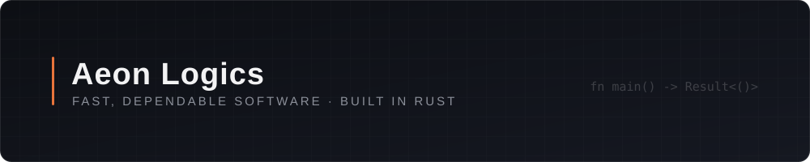

 

I build full-stack web apps, desktop tools and data systems in Rust, with a focus on speed, reliability and software that stays out of the way.

#### Products

- **GlassDB**: a transactional key-value database with ACID guarantees.
- **HisabKitabPro**: inventory and ledger software for businesses that live on accurate records.

#### Open source

- [**aeon-server-explorer**](https://github.com/AeonLogics/aeon-server-explorer): a calm, self-hosted web UI for Docker. Containers, live logs, compose stacks.
- [**sudm**](https://github.com/AeonLogics/sudm): an async CLI for SurrealDB migrations. Scaffolding, timestamped files, live sync.

#### Stack

`Rust` &nbsp;`Leptos` &nbsp;`SurrealDB` &nbsp;`Docker` &nbsp;`Arch Linux` &nbsp;`Zed`
